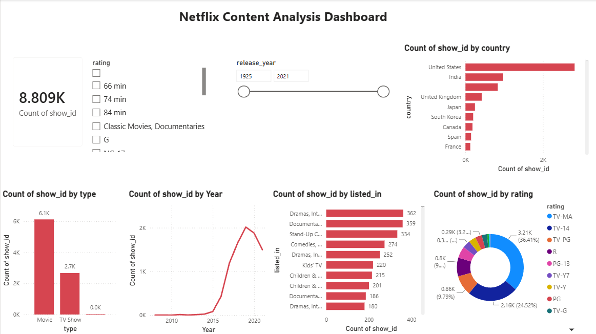

# Netflix Data Analysis

## Objective
Understand what kind of content Netflix has, where it comes from and how it grew over the years.

## Dataset
Public Netflix Movies and TV Shows dataset: 8,807 titles.

## Tools Used
SQL Server (SSMS), Python (Pandas, Kaggle Notebooks), Power BI

## Approach
1. SQL: wrote queries on content type, countries, ratings and genres.
2. Python: cleaned the data and explored it with EDA.
3. Power BI: built a dashboard to show content trends.

## Key Findings
- 6,131 Movies (70%) and 2,676 TV Shows (30%)
- The United States has the most titles (3,689), followed by India (1,046) and the United Kingdom (804)
- Most titles were added in 2019 (2,016), and additions fall after 2019
- Most common rating: TV-MA (3,207 titles), then TV-14
- Top genres: International Movies, Dramas and Comedies

## Dashboard

## Recommendations
- Invest more in TV Shows, since they are only 30% of the catalogue.
- Grow content from India and other international markets.

## Files
- `Netflix Analytics.sql`: SQL queries (SSMS)
- `netflix-analytics.ipynb`: Python EDA notebook
- `Netflix analysis.pbix`: Power BI dashboard
- `netflix_titles.csv`: dataset
